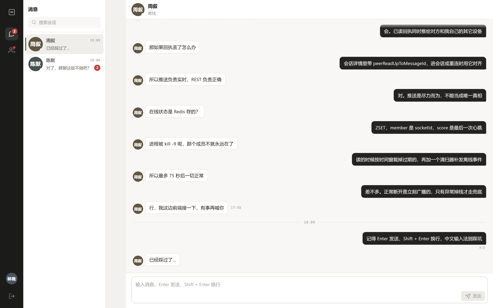
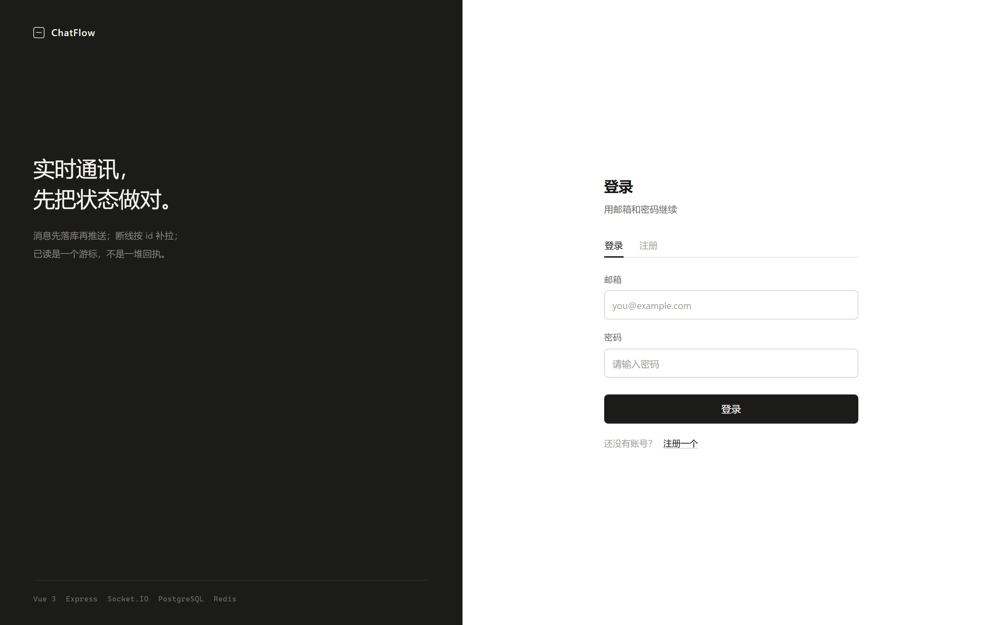
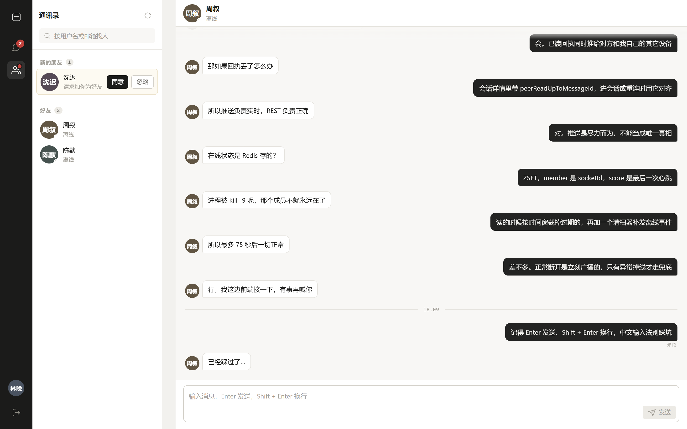
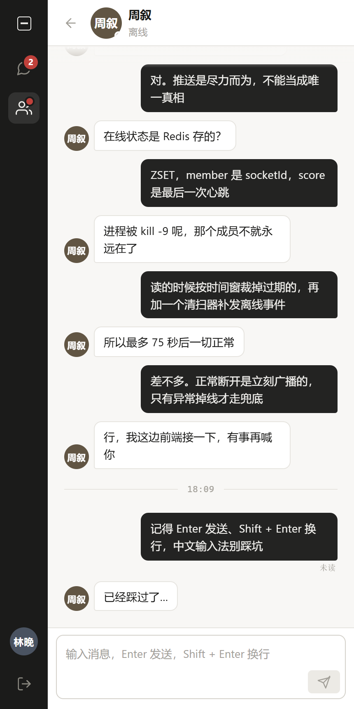

# ChatFlow

一个具备真实业务逻辑的 Web 实时即时通讯系统。全栈手写，用于展示 Node.js 全栈工程能力。

> **在线演示**：<http://47.111.223.71>
>
> 演示账号（密码均为 `chatflow2026`）：`alin@chatflow.dev`（林晚）· `zhou@chatflow.dev`（周叙）· `chen@chatflow.dev`（陈默）· `shen@chatflow.dev`（沈迟）
>
> 要验证实时收发与已读回执：用两个浏览器窗口（或一个普通窗口 + 一个隐身窗口）分别登录林晚和周叙，互发消息即可。
>
> **设计文档**：[`docs/01-架构设计.md`](docs/01-架构设计.md) · **环境搭建**：[`docs/02-环境搭建.md`](docs/02-环境搭建.md) · **接口文档**：[`docs/03-API.md`](docs/03-API.md) · **Socket 协议**：[`docs/04-Socket协议.md`](docs/04-Socket协议.md) · **在线状态**：[`docs/05-Redis在线状态.md`](docs/05-Redis在线状态.md) · **离线消息与已读**：[`docs/06-离线消息与已读状态.md`](docs/06-离线消息与已读状态.md) · **前端设计**：[`docs/07-前端设计.md`](docs/07-前端设计.md) · **测试报告**：[`docs/08-功能与性能测试.md`](docs/08-功能与性能测试.md) · **部署运维**：[`docs/09-部署运维.md`](docs/09-部署运维.md)

---

## 技术栈

| 层 | 技术 |
|---|---|
| 前端 | Vue 3 · Vite · Vue Router · Pinia · Axios · 原生 CSS |
| 后端 | Node.js · Express · Socket.IO · PostgreSQL · Redis · JWT · bcrypt · Multer |
| 部署 | Ubuntu 22.04 · Nginx · PM2 · 阿里云 ECS |

设计取舍：不用 ORM、不用 UI 组件库。手写 SQL 与样式，是为了让数据库设计、索引、事务、布局能力都能被直接看到。

---

## 界面

| 聊天 | 登录 |
|---|---|
|  |  |

| 通讯录（新的朋友） | 窄屏 |
|---|---|
|  |  |

截图是真实运行的服务（`node scripts/seed-demo.mjs` 灌的演示数据），不是设计稿。

---

## 当前进度

| 阶段 | 内容 | 状态 |
|---|---|---|
| 0 | 需求分析、架构设计、数据库设计 | ✅ 完成 |
| 1 | 项目初始化、环境配置、数据库落地 | ✅ 完成 |
| 2 | 用户注册 / 登录 / JWT 鉴权 / 资料 / 头像 | ✅ 完成 |
| 3 | 好友搜索 / 申请 / 管理 | ✅ 完成 |
| 4 | 会话管理、消息模型、历史分页 | ✅ 完成 |
| 5 | Socket.IO 实时通信（含已读回执、断线补拉） | ✅ 完成 |
| 6 | Redis 在线状态（多设备 / 心跳自愈 / 降级） | ✅ 完成 |
| 7 | 离线消息、已读状态（上线汇总 / 多端已读 / 回执可自愈） | ✅ 完成 |
| 8 | 前端界面与异常处理（Vue 3 + Pinia，登录 / 会话 / 聊天 / 通讯录） | ✅ 完成 |
| 9 | 功能测试、性能测试（端到端冒烟 / 接口压测 / 消息吞吐 / 慢查询复核） | ✅ 完成 |
| 10 | 阿里云部署（Nginx 反代 / PM2 / PG+Redis 调参 / 一键发布与回滚） | ✅ 完成 |

---

## 目录结构

```
chatflow/
├─ docs/
│  ├─ 01-架构设计.md        架构、ER、分层、Socket 契约、开发计划
│  ├─ 02-环境搭建.md        本地环境实测记录与操作手册
│  ├─ 03-API.md             接口文档（随阶段推进补充）
│  ├─ 04-Socket协议.md      Socket.IO 事件契约、错误码、客户端接法、重连行为
│  ├─ 05-Redis在线状态.md   在线状态：ZSET + 心跳时间窗、Lua 脚本、幽灵清扫、降级
│  ├─ 06-离线消息与已读状态.md  上线推未读汇总、多端已读同步、回执丢失自愈
│  ├─ 07-前端设计.md        状态划分、实时层状态机、消息合并与乐观发送、错误处理
│  ├─ 08-功能与性能测试.md  冒烟 24 步、接口/消息压测实测数据、慢查询与索引复核
│  └─ 09-部署运维.md        2G 内存账本、Nginx/PM2 配置取舍、发布回滚、排障手册
├─ deploy/                   生产部署
│  ├─ setup-server.sh       服务器初始化（swap/Node/PG/Redis/Nginx/PM2/建库），幂等
│  ├─ release.sh            本机一键发布：构建 → 打包 → 上传 → 重启 → 健康检查
│  ├─ remote-release.sh     服务器端发布：备份 → 解包 → npm ci → 热重载 → 失败自动回滚
│  ├─ nginx/chatflow.conf   静态托管 + /api、/socket.io 反代（含 WebSocket 升级）
│  ├─ pm2/ecosystem.config.cjs  fork 单实例、内存上限、kill_timeout
│  ├─ postgresql/ · redis/ · sysctl/  2 GiB 机器调参
│  └─ env.production.example  生产环境变量模板
├─ db/
│  ├─ 000_drop_all.sql      清空全部对象（重建用）
│  ├─ 001_init.sql          建表 DDL：表 / 约束 / 索引 / 触发器 / 视图
│  ├─ 002_verify_constraints.sql  约束验证脚本（16 项断言，可重复执行）
│  └─ 003_friend_indexes.sql      增量：好友列表的 addressee 侧索引（幂等）
├─ scripts/
│  ├─ dev-db.sh              本地数据库启停管理
│  └─ seed-demo.mjs          演示数据：4 个账号 + 好友关系 + 两段对话（幂等）
├─ client/                   前端（Vue 3 + Vite）
│  ├─ src/api/               HTTP 客户端与各模块接口
│  ├─ src/realtime/          Socket 单例：连接状态机、事件转发、带 ack 的调用
│  ├─ src/stores/            auth / chat / friends / ui
│  ├─ src/views/             LoginView（登录注册）、ChatView（主界面）
│  ├─ src/components/        会话列表、聊天区、消息气泡、通讯录、资料弹窗等
│  ├─ src/utils/             format / messages（消息合并去重）/ id
│  └─ tests/                 纯逻辑单测（41 项）
└─ server/
   ├─ src/
   │  ├─ config/            env / db / redis / logger
   │  ├─ controllers/       只做请求解析与响应
   │  ├─ routes/            只做路由映射
   │  ├─ services/          业务逻辑（唯一入口，HTTP 与 Socket 共用）
   │  ├─ models/            只写 SQL
   │  ├─ middleware/        鉴权 / 校验 / 错误处理
   │  ├─ socket/            Socket.IO 与事件处理
   │  ├─ utils/             ApiError / asyncHandler / directKey
   │  ├─ app.js             只装配 Express
   │  └─ server.js          进程入口
   ├─ scripts/
   │  ├─ bench/             压测：夹具 / HTTP / Socket / 慢查询复核（独立 chatflow_bench 库）
   │  └─ e2e/               端到端冒烟：真实端口 + 真实 socket 跑完整用户旅程
   └─ tests/                Vitest + Supertest（191 项）
```

---

## 快速开始

### 前置要求

- Node.js ≥ 20
- PostgreSQL ≥ 14
- Redis ≥ 5（在线状态需要。不装也能跑，会自动降级为进程内存，但只适合单实例）

本机环境的具体配置见 [`docs/02-环境搭建.md`](docs/02-环境搭建.md)。

### 1. 启动数据库与 Redis

```bash
./scripts/dev-db.sh start                                    # PostgreSQL（端口 5433）
D:/chatflow-dev/redis/redis-server.exe D:/chatflow-dev/redis.conf   # Redis（端口 6379）
```

两个都停掉时，服务仍能启动，只是在线状态走降级分支。

### 2. 建库与建表

```bash
cd server
cp .env.example .env           # 然后修改 DATABASE_URL / JWT_SECRET
npm install
npm run db:init                # 建表到开发库与测试库
```

### 3. 启动后端

```bash
npm run dev                    # node --watch，改代码自动重启
```

本机 3000 端口被别的进程占用时：`PORT=3100 npm run dev`（前端默认也指向 3100）。

访问 <http://localhost:3000/api/health> 应返回：

```json
{
  "ok": true,
  "data": {
    "status": "ok",
    "checks": { "db": "up", "redis": "up", "presence": "redis" }
  }
}
```

`presence` 是在线状态**实际**用的存储：

| 值 | 意思 |
|---|---|
| `redis` | 正常，支持多进程 |
| `memory` | 进程启动时 Redis 不通，已锁定降级。`redis` 可能显示 `up`（后来连上了），但本进程不会中途切回去——**重启才能恢复** |

`redis: "down"` 不影响健康状态：消息、历史、未读全部照常，只有在线状态降级。

### 4. 跑测试

```bash
npm test                       # 后端 191 项（Vitest + Supertest）
npm run smoke                  # 端到端冒烟 24 步（需先启动后端，默认打 3200）
```

冒烟与压测都要先起服务，压测建议用独立的 `chatflow_bench` 库，完整步骤见
[`docs/08-功能与性能测试.md`](docs/08-功能与性能测试.md) 第 9 节。

### 5. 启动前端

```bash
cd ../client
npm install
npm run dev                    # http://localhost:5173
npm test                       # 前端纯逻辑单测 41 项
```

前端通过 Vite 代理访问后端（`/api`、`/uploads`、`/socket.io`），所以**不存在跨域**，
前端代码里也没有任何硬编码的后端地址。后端不在 3100 时：

```bash
VITE_BACKEND=http://localhost:3000 npm run dev
```

### 6. 灌入演示数据（可选）

```bash
cd ..
node scripts/seed-demo.mjs
```

会创建 4 个账号、好友关系、两段对话和一条待处理的好友申请，
可以直接两个浏览器窗口分别登录看实时效果：

| 邮箱 | 密码 | 说明 |
|---|---|---|
| `alin@chatflow.dev`（林晚） | `chatflow2026` | 主账号，与周叙有一段关于实现的对话 |
| `zhou@chatflow.dev`（周叙） | `chatflow2026` | 用来开第二个窗口看实时收发 |
| `chen@chatflow.dev`（陈默） | `chatflow2026` | 有一段未读，用于看未读角标 |
| `shen@chatflow.dev`（沈迟） | `chatflow2026` | 给林晚留了一条待处理的好友申请 |

脚本是幂等的，可以反复跑。

> 未读角标在点开会话后就会被读游标清零 —— 这是正常行为。想再看一次，
> 用 `chen@chatflow.dev` 登录发一条消息即可。

---

## 可用脚本

| 命令 | 作用 |
|---|---|
| `npm run dev` | 开发模式启动（热重启） |
| `npm start` | 生产模式启动 |
| `npm test` | 运行全部测试 |
| `npm run db:init` | 应用 `db/001_init.sql` |
| `npm run db:init -- --force` | 删表重建（会丢数据） |
| `npm run smoke` | 端到端冒烟（真实 HTTP + socket，24 步） |
| `npm run bench:prepare` | 建压测库与夹具（`chatflow_bench`，不碰开发库） |
| `npm run bench:http` | HTTP 接口压测（RPS / 分位延迟 / 错误率） |
| `npm run bench:ws` | Socket 消息吞吐（ack 与投递延迟） |
| `npm run bench:sql` | 慢查询复核（EXPLAIN ANALYZE + 索引命中） |
| `./scripts/dev-db.sh {start\|stop\|status\|psql\|reset}` | 数据库管理 |
| `node scripts/seed-demo.mjs` | 灌入演示账号与对话（幂等） |

前端（`client/`）：

| 命令 | 作用 |
|---|---|
| `npm run dev` | Vite 开发服务器（5173，含代理） |
| `npm run build` | 生产构建到 `dist/` |
| `npm test` | 纯逻辑单测 |

---

## 数据库设计要点

完整说明见 [`docs/01-架构设计.md`](docs/01-架构设计.md) 第 4 节。三个关键约束：

1. **好友关系无向去重** —— `pair_low/pair_high` 生成列 + 唯一索引，A→B 与 B→A 只能存在一行。
2. **单聊会话唯一** —— `conversations.direct_key`（成员 id 升序拼接）+ 唯一索引，并发创建也只会有一条。
3. **消息幂等** —— `UNIQUE(sender_id, client_message_id)`，配合 `ON CONFLICT DO NOTHING` 与回查，重发不产生重复消息。
4. **已读状态只存一个数字** —— `conversation_members.last_read_message_id` 读游标 + `GREATEST` 只增不减。
   未读数、离线消息、已读标记全部由它推导，写入量从 `O(未读数)` 降到 `O(1)`，且天然幂等。

约束验证脚本 `db/002_verify_constraints.sql` 会用真实 SQL 把这 16 条断言逐条撞一遍。

---

## 已知限制

- 本地开发复用了 ThingsBoard 自带的 PostgreSQL 15 二进制（独立实例、独立端口 5433）。若卸载 ThingsBoard 会导致二进制缺失，数据目录可沿用，换二进制即可。
- 在线状态**单实例假设**：优雅退出时 `presence.reset()` 会清空整个库的 `presence:*`，
  两个进程共用一个 Redis 时，一个退出会把另一个的在线用户也抹掉。上多实例要改成"只清自己管的连接"。
- 进程被 `kill -9` 后，好友看到"离线"的最大延迟是 **TTL + 清扫间隔 ≈ 75 秒**（正常断开是立即广播）。
- Socket 层限流（每用户 20 条 / 10 秒）仍是进程内令牌桶，多实例各算各的，实际放行量是 N 倍。
- 改密后旧 token 的 Socket 连接仍然有效（JWT 无状态，只按 `exp` 断开），没有主动失效机制。
- **已读回执是尽力而为**：对方断线时那条 `message:read:update` 直接丢、不补发，
  靠 `GET /conversations/:id` 的 `peerReadUpToMessageId` 在重连时对账。
- **没有「已送达」语义**，消息只有已读/未读两态。要做送达必须由接收端 ack 才算数，
  会引入第二套游标，当前刻意不做。
- `message:offline` 只在连接建立时推一次；连接没断但推送丢失的情况下，客户端不会自己发现。
  彻底解决要靠客户端定期拉 `GET /conversations` 对账。
- 没有单用户连接数上限。同一 token 可以开任意多条连接，每条都占一个 Redis ZSET 成员。
- 未做群聊，`conversations.type` 保留了 `group` 分支。房间模型也只有 `user:<id>`，
  真做群聊需要改成会话房间 + join 时校验成员。
- **好友申请没有实时推送**：后端只做了消息层的 socket 事件，前端靠 30 秒轮询兜底
  （仅在标签页可见时）。要做到即时，得在 `friend.service` 里补 `friend:request` / `friend:accepted` 事件。
- **前端不支持图片消息**，后端 `messageType` 也只放开了 `text`。
- 消息列表**没有虚拟滚动**：一次 30 条、上滑再补，几百条以内没问题，上千条需要窗口化渲染。
- 草稿只存在内存，刷新页面会丢。
