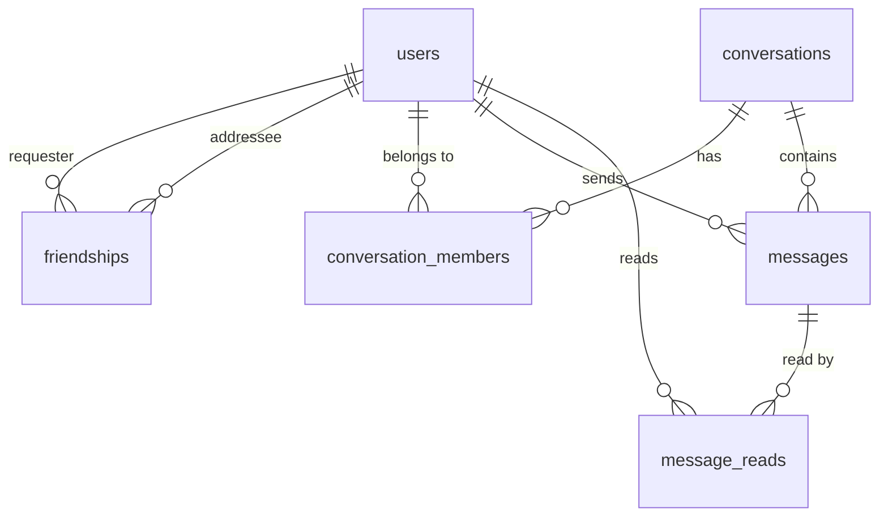

# ChatFlow · 架构设计 v1

> 产出范围：第一步（需求分析 + 技术架构 / ER / 目录 / 计划）与第二步（设计问题预警）
> 状态：**待确认，尚未开始编码**
> 配套文件：`db/001_init.sql`（DDL 设计稿，与本文档同步）

---

## 0. 一句话结论

ChatFlow 真正难的不是"能聊天"，而是三条线：

| 线 | 问题 | 一句话答案 |
|---|---|---|
| 消息可靠性 | 消息会不会丢、会不会重 | **先落库，再推送**；`client_message_id` 唯一索引做幂等 |
| 权限边界 | 会不会看到别人的消息 | 每个 HTTP 接口、每个 socket 事件都单独问一次"你是不是这个会话的成员" |
| 状态与真相分离 | 在线状态准不准 | **PostgreSQL 是唯一真相**，Redis 只是可随时丢弃重建的投影 |

这三条想清楚了，剩下的都是 CRUD。

---

## 1. 需求再分析

### 1.1 拆成不变量（比拆成功能更有用）

需求列了 8 个阶段 40 多条功能，但技术上只有 5 条不变量。**代码要围着不变量写，测试要围着不变量测。**

1. **消息一旦被 ack，就一定能被接收者读到** → 持久化必须先于推送，且推送失败不能回滚消息。
2. **同一条消息无论重发多少次，库里只有一条** → `UNIQUE(sender_id, client_message_id)`。
3. **一对用户最多一条好友关系、最多一个单聊会话** → 交给数据库约束，不交给应用层 `if`。
4. **已读状态是"某人对某会话读到哪了"，不是"消息是否已读"** → 读游标（见 4.3）。
5. **"在线" = 该用户当前活跃连接数 > 0** → 断一个 socket 不等于下线。

> 第 3 条特别值得强调：凡是"唯一"的需求，实现位置一定在数据库。应用层判断在并发下 100% 会出现竞态——两个请求同时 `SELECT` 到"不存在"，然后各插一条。这是最常见的初学者 bug，也是面试官最爱追问的点。

### 1.2 做 / 不做（先把边界钉死）

**做**（对应需求的 8 个阶段）：注册登录、JWT、资料与头像、好友全流程、单聊会话、实时消息、历史分页、在线状态、多设备、离线消息、已读回执。

**明确不做**（需求也没要求，但容易被"顺便加一下"拖死）：

- 群聊（`conversations.type` 留了 `group` 口子，但不实现业务）
- 语音/视频/文件消息（`message_type` 留 `image`，不做）
- 消息撤回、编辑、全文搜索、朋友圈、Web Push、端到端加密

理由：这是求职作品集。**面试官看的是"消息为什么不会丢"讲得清不清楚，不是功能清单有多长。** 每多加一个功能，测试矩阵翻倍，而你的核心叙事会被稀释。

### 1.3 从需求里抽出的隐含硬约束

- "同一对用户只能存在一个有效单聊会话" → 需要一个数据库层面能判定的"用户对"标识（`direct_key`）。
- "好友关系必须保证数据一致性，避免重复添加" → 无向边去重，A→B 和 B→A 是同一条边，靠 `LEAST/GREATEST` 生成列。
- "不能简单地在任意一个 Socket 断开时就把用户标记为离线" → 在线状态必须是**连接集合**，不是布尔值。
- "消息必须持久化，不能只保存在 Redis 中" → 离线消息**不单独存储**，它就是"库里 id 大于我读游标的消息"（见 4.3）。
- "已读状态需要支持不同用户独立记录" → 状态挂在 `(会话, 用户)` 上，不挂在消息上。

---

## 2. 技术选型

### 2.1 沿用你给的栈（全部保留，不换）

| 层 | 选型 | 为什么是它 |
|---|---|---|
| 运行时 | Node.js 20 LTS | 与 Socket.IO 生态最匹配；LTS 保证部署稳定 |
| Web 框架 | Express 4 | 生态最成熟，中间件模型好学，面试可讲的东西多 |
| 实时 | Socket.IO 4 | 自带重连、ack、房间、降级轮询，不用自己写心跳 |
| 数据库 | PostgreSQL 16（Ubuntu 22.04 官方源为 14，够用） | 强约束 + 事务 + 部分唯一索引，正好解你的三个唯一性难题 |
| 缓存/状态 | Redis 7 | 在线状态的连接集合、限流计数 |
| 认证 | jsonwebtoken | — |
| 密码 | **bcryptjs** | 见下方说明 |
| 上传 | Multer | — |

### 2.2 三个我建议调整的点（附原因）

**① `bcrypt` → `bcryptjs`**
`bcrypt` 是 C++ 扩展，Windows 上装不上时要拉 node-gyp + VS Build Tools，一路踩坑。`bcryptjs` 是纯 JS，API 完全一样（`hash`/`compare`），慢约 3 倍但对你这个量级无感。**你的时间应该花在 Socket 鉴权上，不是花在编译工具链上。**

**② 加 `zod`（入参校验）**
需求要求"对用户输入进行校验"。用 zod 而不是 express-validator，原因：一份 schema 能同时给后端校验用、给前端表单用（后续可共享），而且 TS 类型能自动推导。它只有 ~50KB，不算"引入不必要的框架"。

**③ 装 `pg` + `ioredis`，不装 ORM**
不引 Sequelize/Prisma 的理由：本项目的核心卖点是"数据库设计合理"，**手写 SQL 才能让你在面试时讲清楚索引、事务、唯一约束怎么起作用**。ORM 会把这一切藏起来。而且你的查询复杂度（LATERAL、部分索引、`ON CONFLICT`）ORM 表达起来反而更绕。

> 如果后期觉得 CRUD 太啰嗦，再加一层轻量的 `models/*.js` 封装即可——这本来就是需求里的分层要求。

### 2.3 前端

`vue@3` + `vite` + `vue-router@4` + `pinia` + `axios` + `socket.io-client@4` + `dayjs`。

**不引 Element Plus / Naive UI**：作品集里的界面要能看出是你自己写的。用 CSS 变量 + Flex/Grid 手写，工作量可控，而且"手写 IM 布局"本身是个加分项。

### 2.4 明确不装的东西

`@socket.io/redis-adapter`（只在 PM2 多实例时需要，见 §12 风险 3）、`passport`（JWT 场景它是纯负担）、`sequelize`、`typeorm`、`graphql`、`typescript`（第一阶段不上，避免在环境上耗时间；后期可增量接入）。

---

## 3. 系统架构

### 3.1 进程与请求路径

```
                    ┌──────────────────────────────┐
   浏览器            │  Nginx (443/80)              │
   Vue 3 SPA  ──────▶│  ├─ /              → dist/   │
                    │  ├─ /api/*         → :3000   │
                    │  ├─ /socket.io/*   → :3000   │ ← 必须带 Upgrade 头
                    │  └─ /uploads/*     → 静态目录 │
                    └──────────┬───────────────────┘
                               │
                    ┌──────────▼───────────────────┐
                    │  Node.js  (PM2 单实例)        │
                    │  Express  ── HTTP API         │
                    │  Socket.IO ─ 实时通道         │
                    │  services ── 业务逻辑（唯一入口）│
                    └────┬──────────────────┬──────┘
                         │                  │
              ┌──────────▼──────┐  ┌────────▼─────────┐
              │ PostgreSQL      │  │ Redis            │
              │ 唯一真相         │  │ 在线状态/限流     │
              │ 事务/约束/持久化  │  │ 可随时清空重建    │
              └─────────────────┘  └──────────────────┘
```

### 3.2 三条关键设计原则

**① 单一真相（Single Source of Truth）**
所有"用户说了什么、谁是谁的好友、谁读到了哪"都只在 PostgreSQL。Redis 里**只放可以随时丢弃重建的派生数据**（在线连接集合、限流计数）。

这条不是洁癖，是**降级能力**：Redis 挂掉时，注册登录、收发消息、历史记录、未读数量全部照常，只有"在线状态"显示不准。反过来说，如果你把消息或未读数放 Redis，Redis 一挂就是数据丢失——那是面试时最致命的答错。

**② Socket 不是数据通道，是通知通道**
Socket.IO 只负责"推一条消息告诉你：有变化了"。真正取数据走 HTTP。
好处：断线重连逻辑简单（重连后重新拉一次就行），历史消息不用在 socket 上做分页，离线消息天然覆盖。

**③ 业务逻辑只有一层**
HTTP controller 和 socket handler **都只做**：解析入参 → 调 service → 组装返回/emit。
两者共用同一套 service。这样"发消息"的权限校验、事务、幂等只有一份实现，不会出现"HTTP 接口能校验、socket 忘记校验"这种越权漏洞。**这是本项目最重要的一条架构约束。**

---

## 4. 数据库设计

### 4.1 ER 关系说明

6 张表，关系如下：

| 关系 | 基数 | 说明 |
|---|---|---|
| `users` → `friendships` | 1:N（两个方向） | 每条好友关系有 `requester_id` / `addressee_id` 两个外键指向 users |
| `users` ↔ `users`（经 friendships） | N:M | 无向边：A→B 与 B→A 是同一条关系，用 pair 生成列去重 |
| `users` ↔ `conversations`（经 conversation_members） | N:M | 成员表，单聊时恰好 2 行，群聊时 N 行 |
| `conversations` → `messages` | 1:N | 消息的归属，`ON DELETE CASCADE` |
| `users` → `messages` | 1:N | `sender_id`，消息作者 |
| `messages` → `message_reads` ← `users` | N:M | **方案的可选项**，见 4.3 |



**为什么不这样设计**（这些是评审时会被问的）：

- 不把好友列表存成 `users.friends jsonb` 数组 → 无法做外键、无法查"谁申请了我"、删除用户时留下脏数据。
- 不把会话成员存成 `conversations.member_ids int[]` → 无法给"某人有哪些会话"建索引，查询退化成全表扫。
- 不在 `messages` 上放 `is_read` → 需求自己说了原因：一条消息对不同接收者状态不同。单聊里"一个 is_read"碰巧能work，但它是错的抽象，加上群聊立刻崩。

### 4.2 逐表设计

完整 DDL 见 `db/001_init.sql`，这里只讲**关键决策**。

#### users

```sql
id            BIGSERIAL PK
username      VARCHAR(32)   NOT NULL
email         CITEXT        NOT NULL        -- 大小写不敏感
password_hash TEXT          NOT NULL
avatar_url    TEXT
bio           VARCHAR(140)
created_at / updated_at  TIMESTAMPTZ
```

- `email` 用 `CITEXT` 而不是 `VARCHAR`：否则要维护 `lower(email)` 索引，且应用层每次都得记得转小写。**用类型让数据库替你做对的事。**
- `username` 唯一性走 `UNIQUE INDEX ON users (lower(username))`：防止 `Tom` / `tom` 两个账号（钓鱼和混淆的经典来源）。
- `username` 加 GIN trigram 索引支持 `ILIKE '%abc%'` 模糊搜索（好友搜索必需）。
- 密码 varchar 长度给 255：bcryptjs 的 hash 是 60 字符，但**永远不要给密码字段紧贴实际长度的上限**。

#### friendships

```sql
id, requester_id, addressee_id, status, created_at, updated_at
pair_low  BIGINT GENERATED ALWAYS AS (LEAST(requester_id, addressee_id)) STORED
pair_high BIGINT GENERATED ALWAYS AS (GREATEST(requester_id, addressee_id)) STORED
UNIQUE INDEX (pair_low, pair_high)
CHECK (requester_id <> addressee_id)
```

**这是全库最巧的一处。** 好友关系是**无向图**，但表存的是有向行。如果只 `UNIQUE(requester_id, addressee_id)`：

- A 申请 B → 插入 `(A,B)`
- B 申请 A → 插入 `(B,A)`，**唯一约束拦不住**

解法：用两个 `GENERATED` 列把二元组规范化成有序对 `(low, high)`，对它建唯一索引。`LEAST/GREATEST` 是数据库算的，应用层改不动，所以约束是不可绕过的。

配套策略：**一对用户永远只有一行**，状态机流转：

```
（无）──INSERT──▶ pending ──accept──▶ accepted
                    │                    │
                    └──reject──▶ rejected └──DELETE──▶ （删除行）
                         │
                         └──再次申请──▶ pending（原地 UPDATE）
```

"被拒绝后能再次申请"靠 `ON CONFLICT (pair_low, pair_high) DO UPDATE` 复活这一行，而不是插新行。
代价：丢掉了"谁在什么时候被拒过"的历史。**作品集场景值得，因为换来的是"永远不可能有重复好友"的强保证。**

#### conversations

```sql
id          BIGSERIAL PK
type        VARCHAR(16)  NOT NULL DEFAULT 'direct'   -- direct | group
direct_key  VARCHAR(64)  UNIQUE                      -- 'direct:12:34'（成员 id 升序）
title       VARCHAR(64)                              -- 群聊预留
created_at / updated_at TIMESTAMPTZ
CHECK (type <> 'direct' OR direct_key IS NOT NULL)
```

**单聊唯一性怎么保证？** 不能靠 `conversation_members` 的唯一约束——那只能保证"同一会话里不重复加人"，保证不了"这两个人只有一个会话"。

解法：`direct_key = 'direct:' || LEAST(a,b) || ':' || GREATEST(a,b)`，加 `UNIQUE`。
创建会话时直接：

```sql
INSERT INTO conversations (type, direct_key) VALUES ('direct', $1)
ON CONFLICT (direct_key) DO NOTHING
RETURNING id;
```
连"先查再插"的竞态都不存在了，并发下也只会有一条。**这是"用数据库约束代替应用层判断"的教科书案例，面试必讲。**

> 说明：这里刻意**没有**加 `last_message_id` / `last_message_at` 冗余字段。理由：冗余字段意味着"发消息"事务里必须同步更新它，一旦漏更新就出现"会话列表显示旧消息"的诡异 bug。作品集量级下用 `LATERAL` 取最后一条消息（有索引，微秒级）就够了。
> **什么时候该加**：压测后发现会话列表接口 P95 > 200ms 时再加，那时你有数据支撑这个决定。

#### conversation_members

```sql
id, conversation_id, user_id, role, joined_at
last_read_message_id BIGINT          -- ★ 读游标
last_read_at         TIMESTAMPTZ
UNIQUE (conversation_id, user_id)
INDEX (user_id)
```

`UNIQUE(conversation_id, user_id)` 保证"同一人不会被重复加进同一会话"——加了 `ON CONFLICT DO NOTHING` 之后，`POST /conversations` 重复调用也安全。

**`last_read_message_id` 是解决"未读数"和"已读回执"的唯一状态位**，详见下一节。

#### messages

```sql
id, conversation_id, sender_id
client_message_id UUID NOT NULL      -- ★ 幂等键
content TEXT
message_type VARCHAR(16) DEFAULT 'text'
created_at TIMESTAMPTZ
deleted_at TIMESTAMPTZ               -- 软删除
UNIQUE INDEX (sender_id, client_message_id)
INDEX (conversation_id, id DESC)     -- ★ 分页主力索引
CHECK (char_length(content) BETWEEN 1 AND 4000)
```

- `client_message_id` 由**前端生成**（`crypto.randomUUID()`），随消息一起发。这是"消息不重复"的唯一手段。
- 分页索引用 `(conversation_id, id DESC)` 而不是 `(conversation_id, created_at)`：`id` 是 BIGSERIAL，天然单调，游标分页直接 `WHERE id < $cursor`，不会因为同一毫秒有多条消息而错位或漏条。**用 created_at 做游标是新手经典坑。**

#### message_reads（**需要你决策**）

按需求建表是：

```sql
message_id, user_id, read_at, PRIMARY KEY (message_id, user_id)
```

但见 4.3，我建议**不写这张表**，或者只在阶段 7 真的需要群聊"已读列表"时再加。

### 4.3 已读状态：建议从 `message_reads` 改成"读游标"

需求原文：

> 建议使用独立的消息读取状态设计，避免简单地给消息表增加一个全局 is_read 字段，因为同一条消息可能涉及不同接收者。

方向是对的，但 `message_reads`（每消息每接收者一行）是"正确但昂贵"的解法。对比：

| | per-message 行（message_reads） | 读游标（conversation_members.last_read_message_id） |
|---|---|---|
| 行数 | 消息数 × 接收者数（单聊=消息数，群聊×N） | **固定 = 成员数** |
| 写入 | 打开会话时，未读 200 条 → 插 200 行 | **1 行 UPDATE** |
| 未读数 | `COUNT(*)` over 未读行 | `COUNT(*) WHERE id > cursor`（索引范围扫） |
| "对方读了吗" | 查该消息有无 read 行 | `cursor >= message.id` |
| 群聊"谁读了" | 天生支持 | 不支持（需要额外表） |

**结论**：单聊场景下，游标方案在写入量上是 200:1 的优势，功能上完全等价——微信/WhatsApp 的"双蓝勾"本质就是游标。

所以方案定为：

```sql
-- 收到 message:read 事件时，一条 UPDATE 搞定，且必须单调不回退
UPDATE conversation_members
SET last_read_message_id = GREATEST(COALESCE(last_read_message_id, 0), $2),
    last_read_at = now()
WHERE conversation_id = $1 AND user_id = $3;
```

`GREATEST` 保证乱序到达（网络抖动导致的旧请求后到）不会把游标往回拉——**不需要额外加锁，这就是幂等**。

未读数一个 SQL 拿全套（会话列表直接复用）：

```sql
SELECT c.id, c.type, m.*, COALESCE(unread.cnt, 0) AS unread_count
FROM conversation_members cm
JOIN conversations c ON c.id = cm.conversation_id
LEFT JOIN LATERAL (
  SELECT * FROM messages
  WHERE conversation_id = c.id AND deleted_at IS NULL
  ORDER BY id DESC LIMIT 1
) m ON true
LEFT JOIN LATERAL (
  SELECT count(*) AS cnt FROM messages
  WHERE conversation_id = c.id
    AND id > COALESCE(cm.last_read_message_id, 0)
    AND sender_id <> cm.user_id
    AND deleted_at IS NULL
) unread ON true
WHERE cm.user_id = $1
ORDER BY COALESCE(m.created_at, c.created_at) DESC
LIMIT 50;
```

> **需要你确认**：如果坚持要 `message_reads` 表，我会建表并在阶段 7 用它实现"逐条已读"，但会额外引入写放大。两个方案我都能实现，我推荐游标。

### 4.4 事务边界清单

**只有这 5 个操作需要事务**，其余单条 SQL 自带原子性。这个清单直接对应"关键业务操作使用数据库事务"的要求。

| # | 操作 | 事务内做什么 | 为什么必须 |
|---|---|---|---|
| 1 | 同意好友申请 | 查行 `FOR UPDATE` → 校验 `status='pending'` 且我是 addressee → `UPDATE status='accepted'` → `INSERT conversations ON CONFLICT DO NOTHING` → `INSERT conversation_members ×2 ON CONFLICT DO NOTHING` | 否则出现"好友关系是 accepted 但没有会话"的孤儿状态 |
| 2 | 发送好友申请 | `SELECT ... FOR UPDATE` 查 pair → 不存在则 INSERT，`rejected` 则 UPDATE 回 pending，`accepted` 则报错，`pending` 且对方申请我则提示"可直接同意" | 防并发重复申请（唯一索引兜底，但业务语义要判） |
| 3 | 发送消息 | `INSERT messages ON CONFLICT DO NOTHING RETURNING *` → 若返回空说明是重发，回查已有行 | 事务主要为了拿到"是新插还是重复"的确定性结果；幂等靠唯一索引，不靠事务 |
| 4 | 标记已读 | 校验成员 → `UPDATE ... GREATEST(...)` → 查发送者游标用于回执 | 需要"更新后立刻读回"的一致视图 |
| 5 | 删除好友 | 删 friendship 行 → 会话是保留还是删除（见 4.5） | 两个动作必须同时成功或同时失败 |

**事务写法约束**：一律用 `await pool.connect()` + `BEGIN/COMMIT/ROLLBACK` + `finally { client.release() }` 的显式模式，业务代码里**禁止直接用 `pool.query` 开事务**（连接不同就不在一个事务里了，这是 pg 最常见的坑）。封装一个 `withTransaction(fn)` 统一处理。

### 4.5 删除策略

| 对象 | 策略 | 理由 |
|---|---|---|
| 用户 | 不做硬删除（作品集无"注销"需求），仅设 `ON DELETE CASCADE` 兜底 | 删用户牵连太广 |
| 好友关系 | **硬删除** | 记录无价值，保留会让"重新加好友"逻辑变复杂 |
| 单聊会话 | **删除好友时保留会话和消息**（只删 friendship 行） | 聊天记录是用户资产；重新加好友后 `direct_key` 冲突会复用原会话，历史自动回来 |
| 消息 | **软删除** `deleted_at` | 需求有"避免重复展示"和多端一致性要求；硬删会让"对方那边"的引用断裂 |
| 头像文件 | 换头像时删旧文件 | 但 DB 更新成功后才删，且删失败只打日志不报错 |

### 4.6 关键查询 ↔ 索引映射

这张表是"索引合理"要求的直接证据，也方便后面用 `EXPLAIN ANALYZE` 验收。

| 查询 | 走的索引 |
|---|---|
| 登录（按 email） | `users_email_unique` (citext) |
| 搜索用户 `username ILIKE '%x%'` | `users_username_trgm_gin` |
| 我收到的待处理申请 | `friendships_addressee_pending_idx`（部分索引） |
| 我的好友列表 | `friendships_pair_uk` 的反向使用 + `requester_id` 索引 |
| 查两人是否好友 | `friendships_pair_uk`（唯一索引点查） |
| 我的会话列表 | `conversation_members_user_idx` |
| 历史消息分页 | `messages_conv_cursor_idx` |
| 未读数 | `messages_conv_cursor_idx`（范围扫描） |
| 幂等检查 | `messages_idem_uk`（唯一索引） |

### 4.7 实测记录：小表上计划器不会用复合索引（正常现象）

阶段 1 用 `EXPLAIN ANALYZE` 实测发现，**1 万行数据时**分页查询走的是 `messages_pkey`：

```
Limit
  -> Index Scan Backward using messages_pkey on messages
       Index Cond: (id < 9000)
       Filter: (conversation_id = 7)
       Rows Removed by Filter: 564        ← 扫了 594 行才拿到 30 行
```

把数据量提到 **20 万行 / 100 个会话**后，同一个查询立刻切换到复合索引：

```
Limit (cost=0.42..93.63 rows=30)
  -> Index Scan using messages_conv_cursor_idx on messages
       Index Cond: ((conversation_id = 37) AND (id < 150000))
```

**结论：索引设计没问题，是代价模型的正常行为。** 表小的时候全表/主键扫描本来就更便宜，PG 选得更"划算"的方案是对的。

**排查这类问题的方法**（以后自己遇到别慌）：

1. 先看 `Rows Removed by Filter`：如果远大于返回行数，说明索引没起到过滤作用
2. 再用 `EXPLAIN (ANALYZE, BUFFERS)` 看实际耗时，别只看有没有走索引
3. 最后用**有代表性的数据量**复测，几千行测不出真实计划

顺带确认：未读数统计在两种数据量下都稳定走 `messages_conv_cursor_idx`（Bitmap Index Scan + Recheck Cond）。

---

## 5. 后端结构

### 5.1 目录

```
server/
├─ src/
│  ├─ config/
│  │   ├─ env.js            # 读取+校验环境变量（启动即失败，别等运行时报错）
│  │   ├─ db.js             # pg Pool + withTransaction()
│  │   ├─ redis.js          # ioredis 客户端（2 个：普通 + subscriber）
│  │   └─ logger.js         # 统一日志
│  ├─ models/               # 只写 SQL，不写业务判断
│  │   ├─ user.model.js
│  │   ├─ friendship.model.js
│  │   ├─ conversation.model.js
│  │   └─ message.model.js
│  ├─ services/             # 业务逻辑 + 事务 + 权限校验（唯一入口）
│  │   ├─ auth.service.js
│  │   ├─ user.service.js
│  │   ├─ friend.service.js
│  │   ├─ conversation.service.js
│  │   ├─ message.service.js
│  │   └─ presence.service.js
│  ├─ controllers/
│  ├─ routes/
│  ├─ middleware/
│  │   ├─ auth.js           # requireAuth: JWT → req.auth.userId
│  │   ├─ validate.js       # zod schema 校验（并剥掉未声明字段）
│  │   ├─ rateLimit.js      # 登录/注册/写操作限流
│  │   ├─ error.js          # 统一错误处理（最后挂）
│  │   ├─ notFound.js
│  │   └─ upload.js         # multer memoryStorage + 体积限制
│  ├─ validators/           # zod schema（入参契约）
│  │   ├─ auth.validator.js
│  │   └─ user.validator.js
│  ├─ socket/
│  │   ├─ index.js          # io 初始化 + 中间件注册
│  │   ├─ auth.js           # handshake JWT 鉴权
│  │   ├─ handlers/
│  │   │   ├─ message.handler.js
│  │   │   ├─ read.handler.js
│  │   │   └─ presence.handler.js
│  │   └─ emitter.js        # 封装"推给某人/某会话"，避免各处硬编码 room 名
│  ├─ utils/
│  │   ├─ jwt.js
│  │   ├─ ApiError.js       # 带 code + httpStatus 的错误类
│  │   ├─ asyncHandler.js   # 包 async 路由，省 try/catch
│  │   └─ directKey.js
│  ├─ app.js                # 只装配 Express（可被测试直接 import）
│  └─ server.js             # http.createServer + socket + listen（进程入口）
└─ tests/
```

### 5.2 分层契约（谁能调谁）

```
routes → controllers → services → models → (pg)
                ↑            ↑
         middleware    socket/handlers
```

**硬规则，写进 README 和 code review checklist：**

1. `controllers` / `socket handlers` **禁止** import `models`，只能调 `services`。
2. `services` **禁止**接触 `req` / `res` / `socket` 对象，只接受普通参数。这样同一份逻辑既能被 HTTP 调也能被 socket 调，还能被测试直接调。
3. `models` **禁止**做权限判断和业务分支，只做 SQL。
4. `app.js` **禁止**包含任何业务逻辑——它只应该是中间件装配清单。这条是需求明确要求的。

### 5.3 统一错误与响应

```js
// 成功
{ "ok": true, "data": { ... } }
// 失败
{ "ok": false, "error": { "code": "CONVERSATION_FORBIDDEN", "message": "无权访问该会话" } }
```

错误码用**大写下划线常量**，前端按 `code` 分支而不是按中文文案分支。
登录失败统一返回 `AUTH_INVALID_CREDENTIALS`（不区分"邮箱不存在"和"密码错"）——需求明确要求，防用户枚举。

`ApiError` 类 + `asyncHandler` + 全局 error 中间件，三件套解决"必要的错误处理"。

---

## 6. 前端结构

```
client/src/
├─ api/
│  ├─ http.js            # axios 实例 + 请求/响应拦截器（注入 token、统一错误弹 toast）
│  ├─ auth.api.js
│  ├─ user.api.js
│  ├─ friend.api.js
│  └─ conversation.api.js
├─ sockets/
│  ├─ index.js           # 单例 socket + 生命周期管理
│  └─ events.js          # 事件名常量（与后端保持一致）
├─ stores/
│  ├─ auth.store.js      # user / token / login / logout / restore
│  ├─ chat.store.js      # 会话列表 / 当前会话 / 消息 map / 未读数
│  └─ friend.store.js    # 好友 / 申请
├─ views/
│  ├─ LoginView.vue
│  ├─ RegisterView.vue
│  ├─ ChatView.vue       # 主界面（三栏布局的容器）
│  └─ ProfileView.vue
├─ components/
│  ├─ sidebar/           # UserCard / ConversationList / FriendList / SearchBox
│  ├─ chat/              # ChatHeader / MessageList / MessageBubble / MessageInput
│  ├─ friend/            # FriendRequestList / AddFriendModal
│  └─ common/            # Avatar / EmptyState / Loading / ErrorState / Toast
├─ router/index.js       # 路由守卫（未登录跳 /login）
├─ utils/                # 时间格式化、uuid、防抖
├─ styles/               # CSS 变量 + reset
├─ App.vue
└─ main.js
```

### 6.1 状态划分的关键决策

| Store | 存什么 | 为什么不放别处 |
|---|---|---|
| `auth` | user、token | token 是全局唯一的"我是谁" |
| `friend` | 好友列表、申请列表 | 跨页面复用（侧栏 + 搜索 + 资料页） |
| `chat` | 会话列表、消息缓存 `Map<convId, Message[]>`、未读数 | 消息必须按会话分组缓存，切换会话时不重新拉 |

- **消息用 `Map<conversationId, Message[]>`**，不用扁平数组。切换会话零成本，未读数按 key 更新。
- **未读数放 store，不放组件**：socket 推送 `message:receive` 时，如果当前不在该会话，store 的未读数 +1，侧栏立刻变红点。组件只管展示。
- **本地去重**：消息入 store 前按 `clientMessageId` 和 `id` 双键判重（`message:ack` 和 HTTP 拉取可能同时到达同一条）。

### 6.2 Socket 客户端封装

```js
// sockets/index.js 的职责，不要散落到组件里
connect(token)      // 建立连接，auth: { token }
on('message:receive', handler)   // 统一在 store 里注册，不在组件里
disconnect()        // 登出时断开，防止 token 泄漏后被复用
reconnect 时 → 主动触发一次"补拉"（见 §9.5）
```

组件里**禁止**直接 `import { io }`。

---

## 7. Socket 事件契约

### 7.1 握手鉴权

```js
// 客户端
io(URL, { auth: { token: accessToken }, transports: ['websocket', 'polling'] })

// 服务端（server/src/socket/auth.js，已实现）
io.use((socket, next) => {
  const token = socket.handshake.auth?.token;      // 只从 auth 或 Authorization 头取，不从 query 取
  if (!token) return next(err(ErrorCodes.AUTH_REQUIRED));

  const { userId, exp } = verifyAccessToken(token);  // 直接复用 HTTP 的校验，不另写一套
  socket.data.userId = userId;                       // 只信任签名，不信任任何客户端传来的 userId
  scheduleExpiryDisconnect(socket, exp);             // 到点主动断开，长连接不会"永久有效"
  next();
});
```

**关键点**：`socket.data.userId` 只能来自 JWT 的 `sub`。客户端在 payload 里塞 `senderId` 一律忽略——这是 Socket.IO 最常见的越权漏洞（测试 `payload 里伪造 senderId 无效` 守着这条）。

**第二个关键点**：HTTP 每条请求都重新校验 token，长连接不会。所以必须按 `exp` 自己定时断开，
否则"登录 2 小时过期"对 socket 完全不生效——连接一旦建立就能永久收发。

### 7.2 事件表（已实现，详见 `docs/04-Socket协议.md`）

| 事件 | 方向 | Payload | 说明 |
|---|---|---|---|
| `message:send` | C→S | `{ conversationId, content, clientMessageId?, messageType? }` | 带 ack 回调 |
| `message:sync` | C→S | `{ conversationId, after, limit? }` | 断线重连后补拉漏收的消息 |
| `message:read` | C→S | `{ conversationId, messageId }` | 推进读游标 |
| `message:receive` | S→C | `{ message }` | 推给接收者**所有设备** + 发送者其他设备 |
| `message:ack` | S→C | `{ ok, data\|error }` | 仅当 `message:send` 没传 ack 回调时 |
| `message:read:update` | S→C | `{ conversationId, userId, upToMessageId, readAt }` | 对端的读游标前进了 |
| `user:online` / `user:offline` | S→C | `{ userId }` | 只推给该用户的好友 |
| `auth:expired` | S→C | `{ code }` | token 到期，随后断开 |
| `server:shutdown` | S→C | `{ retryAfterMs }` | 重启前通知 |

> 已按建议改名：上行 `message:read`，下行 `message:read:update`。
> 另外补了 `message:sync` —— 需求里没写，但不做的话断线期间的消息只能靠刷新页面找回。

### 7.3 房间模型（已实现，与草案不同）

- `user:{userId}` —— 连接时由**服务端**按 token 里的 id 自动加入，客户端无接口可调。
- `conv:{conversationId}` —— **最终没有实现**。单聊里"推给会话"和"推给对话双方"是同一件事，
  而会话房间要求客户端 join，join 就要做成员校验，等于自己开一个越权入口。
  真做群聊时再加，见 `docs/04-Socket协议.md` §7.1。

### 7.4 消息发送的完整时序（最重要的一段）

```
客户端                服务端                         PostgreSQL
  │
  ├─ message:send ─────▶
  │                     ├─ 1. socket.userId 已由握手确定
  │                     ├─ 2. 校验：是否为该会话成员 ──▶ SELECT 1 FROM conversation_members
  │                     ├─ 3. 限流：Redis 计数
  │                     ├─ 4. 内容校验（长度/类型/非空）
  │                     ├─ 5. INSERT ... ON CONFLICT (sender_id, client_message_id) DO NOTHING
  │                     │                              RETURNING *
  │                     │   ├─ 有返回 → 新消息
  │                     │   └─ 无返回 → 重发，回查已存在的那条
  │  ◀── message:ack ───┤ 6. 先 ack 发送者（含 clientMessageId 映射）
  │                     ├─ 7. 推 message:receive 到 user:{接收者} + user:{发送者其他设备}
  │  ◀── message:receive┘
```

**顺序不可调换**：`INSERT` 成功后才有 ack 和推送。

实现上顺序是 `INSERT → 推给接收者 → 回 ack`（见 `server/src/socket/handlers.js`）：
acks 只是一次响应，晚几毫秒无所谓；推送才是对端的实时性来源，不该排在 ack 后面等。
反过来（先推送后落库）就会出现"对方看到了、库里没有"——刷新页面消息消失，这是 IM 系统最典型的 bug。

**同样重要的是：走 HTTP 发消息也必须推送。** 两条通道共用 `socket/delivery.js`，
否则前端一旦混用（发送走 REST、接收走 socket），对方就永远收不到实时消息。

**推送给接收者失败怎么办？** 不回滚。消息已经在库里了，接收者下次上线或重连时通过 HTTP 拉取会得到它。**这就是"离线消息"不需要单独存储的根本原因。**

---

## 8. Redis 设计

### 8.1 Key 规范

| Key | 类型 | TTL | 用途 |
|---|---|---|---|
| `presence:{userId}` | ZSET（member=socketId, score=心跳时间戳） | 无（定期裁剪） | 在线连接集合 |
| `rl:msg:{userId}` | STRING 计数 | 10s | 消息限流 |
| `rl:login:{ip}` | STRING 计数 | 60s | 登录爆破防护 |

**统一前缀 + 冒号分层 + 单一职责**，key 名写进 `config/redis.js` 的常量，禁止在业务代码里拼字符串。

### 8.2 在线状态：为什么是 ZSET 而不是 SET / 布尔值

需求的两条硬要求：
- 不能任意一个 socket 断开就标记离线（多设备）
- 支持异常断开后的状态清理（进程被 kill -9，finally 里的清理代码根本不执行）

| 方案 | 多设备 | 崩溃自愈 | 结论 |
|---|---|---|---|
| `SET online:{uid} '1' EX 60` | ❌ 一个断开就删了 | 部分 | 不满足需求 |
| `SET` 存 socketId 集合，`SCARD` 判断 | ✅ | ❌ 进程崩溃留下幽灵成员，永远显示在线 | 不满足 |
| **ZSET 存 socketId + 心跳时间戳** | ✅ | ✅ 用时间窗过滤 | **采用** |

```js
// 连接
await redis.zadd(`presence:${uid}`, Date.now(), socketId);
// 心跳（socket.io 的 ping，或服务端 30s 定时器）
await redis.zadd(`presence:${uid}`, Date.now(), socketId, 'XX'); // 只更新已存在成员
// 断开
await redis.zrem(`presence:${uid}`, socketId);

// 判断在线：只数最近 90 秒内有心跳的连接
const online = await redis.zcount(`presence:${uid}`, Date.now() - 90_000, '+inf');
```

幽灵成员会被时间窗自动过滤，**不需要任何"清理任务"就实现了崩溃自愈**——这是 ZSET 方案相比 SET 的核心优势。

### 8.3 在线/离线事件的触发条件（需求特别点名的坑）

```
连接数 0 → 1  : 广播 user:online 给好友
连接数 > 1    : 什么都不做（第二台设备上线，对好友而言状态没变）
连接数 1 → 0  : 广播 user:offline 给好友
连接数 > 1    : 什么都不做（一台设备下线，另一台还在）
```

判断"是不是从 0 变 1"必须在 `ZADD` **之前**先 `ZCOUNT`，并且用 Lua 脚本或 `MULTI` 保证两步原子——否则并发连接时两台设备都读到 0，各广播一次 `user:online`（好友那边会看到状态闪一下）。

### 8.4 好友列表的在线状态怎么查

`GET /friends` 时对每个好友 `ZCOUNT`——N 次往返。N 小的时候可接受，但更优解是 **`ZCOUNT` 批量用 pipeline**：

```js
const pipe = redis.pipeline();
friends.forEach(f => pipe.zcount(`presence:${f.id}`, now - 90_000, '+inf'));
const counts = await pipe.exec();
```

**不要**用 `SCAN` 或 `KEYS` 遍历所有在线用户——`KEYS` 是阻塞命令，生产环境禁用。

### 8.5 实现修正（阶段 6 落地后回看 §8.2–8.4）

上面 8.2–8.4 是阶段 0 的设计稿。真正写完之后有三处必须更正，完整版见 [`05-Redis在线状态.md`](05-Redis在线状态.md)：

| 设计稿 | 实际情况 | 为什么 |
|---|---|---|
| "不需要任何清理任务就实现了崩溃自愈" | **查询确实自愈，但通知不会自己发出** | 时间窗只让"读到的状态"是准的；好友界面那个绿点是在等 `user:offline` 事件，而这个事件只有 `disconnect` 回调会发。`kill -9` 时它不存在 → 必须补一个 15s 的清扫器 |
| key `presence:{uid}`，窗口 90s | `presence:sock:{uid}` + `presence:users` 两个 key，TTL 60s | 第二个 key 让清扫器能直接枚举"谁可能掉线"，不必 `SCAN`；TTL 取 2.4× pingInterval(25s) 已够，90s 让离线体感太慢 |
| `ZADD ... XX` 更新心跳 | Lua 里先 `ZSCORE` 判断存在，不存在直接返回 | `XX` 只能防"新增"，但断开/过期后成员已不在，语义上等价；用 Lua 是因为要把计数和过期裁剪放在同一个原子操作里 |
| 只提"pipeline 更优" | 已实测：50 人 0.704ms vs 逐个 8.9ms | 差 12.6 倍，瓶颈是往返次数 |

---

## 9. 十大技术难点逐条方案

| # | 难点 | 方案（代码里必须真实现） |
|---|---|---|
| 1 | Socket.IO 如何 JWT 鉴权 | `io.use` 中间件从 `handshake.auth.token` 验签，只取 `sub` 作为身份，忽略 payload 里的任何 userId。鉴权失败 `next(new Error(...))`，客户端在 `connect_error` 里区分"token 过期"→ 刷新后重连 |
| 2 | 防止访问别人的会话 | **唯一入口**：`assertMembership(userId, conversationId)`，在 service 层最开头调用，HTTP 和 socket 共用。查询走 `UNIQUE(conversation_id, user_id)` 索引。**所有**涉及会话的接口都必须过这一关，包括"标记已读"和"拉历史" |
| 3 | 消息先保存再推送 | 见 7.4 时序。代码评审时检查点：`emit` 语句是否出现在 `INSERT` 的 `await` 之后 |
| 4 | 消息重复发送 | 三层防御：① 前端按钮 loading 禁用；② 前端每次输入生成 `clientMessageId`（重试时复用同一个）；③ 数据库唯一索引 + `ON CONFLICT DO NOTHING` + 回查。测试用"同一 uuid 连发 3 次"验证库里只有 1 条 |
| 5 | 断线重连 | 客户端 `reconnect: true` + 指数退避；`on('connect')` 时重发 `auth`、重新 `join` 房间、按 `lastKnownMessageId` 补拉当前会话。补拉用 HTTP `?after=<id>`，不去 socket 上做分页 |
| 6 | Redis 管理在线状态 | 见 §8 |
| 7 | 多设备同时在线 | ZSET 存多个 socketId；推送发 `user:{uid}` 房间覆盖所有设备；已读游标是会话级而不是连接级，所以 A 设备读过了，B 设备的未读数也应该消失（靠 `message:read:update` 广播到自己的 `user:` 房间实现） |
| 8 | 离线消息 | **不单独存储**。离线消息 = `messages WHERE conversation_id=? AND id > 我的last_read_message_id`。上线时 `GET /conversations` 拿到未读数，打开会话时按游标拉取。好处：无"离线队列"的生命周期管理，无重复投递问题 |
| 9 | 消息已读 | 读游标 + `GREATEST` 单调更新（见 4.3）。发送者渲染"已读"：`peerLastReadMessageId >= message.id` |
| 10 | 事务一致性 | `withTransaction(fn)` 封装 + §4.4 的 5 个事务边界。**禁止嵌套事务**（用同一个 client 递归会死锁），需要复用时把内层函数改成接受 `client` 参数 |

---

## 10. 安全清单

上线前逐项打勾，也作为面试自述的提纲：

- [ ] 密码 `bcryptjs` hash，cost=10；响应里**永不**返回 `password_hash`（在 model 层就用 `SELECT` 白名单字段，而不是 `SELECT *` 再删）
- [ ] JWT `HS256` + 32 字节以上随机 secret，`expiresIn` 设 2h；payload 只放 `sub`，不放邮箱和昵称
- [ ] 所有 `/api/*`（除 `/auth/*`）走 `verifyJWT` 中间件
- [ ] 每条 SQL 用参数化查询（`$1,$2`），**绝无**字符串拼接 → SQL 注入
- [ ] 所有入参 zod 校验（长度、格式、枚举、数字范围）
- [ ] 登录/注册加 `express-rate-limit`，失败统一文案
- [ ] `helmet()` + CORS 白名单（生产只允许自己的域名）
- [ ] 头像上传：限 2MB、只允许 `image/jpeg|png|webp`、**校验真实 MIME 不只看扩展名**、文件名用 `uuid` 重写（不用用户原文件名，防路径穿越 `../../`）、存到非 Web 根目录
- [ ] 越权测试用例：用 A 的 token 访问 B 的 `conversationId`，必须 403
- [ ] 消息内容前端渲染用 `{{ }}` 插值（Vue 自动转义），**不使用 `v-html`**
- [ ] `.env` 进 `.gitignore`，提供 `.env.example`

---

## 11. API 草案

前缀 `/api`。完整文档（含请求/响应示例、错误码表）在阶段 8 补齐。

| Method | Path | 说明 |
|---|---|---|
| POST | `/auth/register` | 注册（限流：5 次/小时/IP） |
| POST | `/auth/login` | 登录，返回 token + user（限流：10 次/15 分钟/IP） |
| GET | `/auth/me` | 用 token 换当前用户（刷新页面恢复登录态） |
| PATCH | `/users/me` | 改用户名/简介（**路径无 id，目标恒为本人**） |
| PATCH | `/users/me/password` | 改密码（需旧密码） |
| POST | `/users/me/avatar` | 上传头像（multipart，字段名 `avatar`） |
| GET | `/users/search?q=` | 搜用户（返回与我的关系状态，便于按钮显示"添加/已申请/已是好友"） |
| GET | `/friends` | 好友列表（含在线状态） |
| DELETE | `/friends/:userId` | 删好友 |
| POST | `/friends/requests` | 发申请 `{ addresseeId }` |
| GET | `/friends/requests?box=incoming\|outgoing` | 申请列表 |
| PATCH | `/friends/requests/:id` | `{ action: 'accept' \| 'reject' }` |
| GET | `/conversations` | 会话列表（含最后一条消息 + 未读数） |
| POST | `/conversations` | 创建/获取单聊 `{ peerUserId }`（幂等） |
| GET | `/conversations/:id/messages?before=&after=&limit=` | 历史分页（游标） |
| POST | `/conversations/:id/read` | `{ lastMessageId }` HTTP 兜底（主要走 socket） |

**分页约定**：统一 `before=<messageId>&limit=30` 向下翻页，返回 `{ items, hasMore }`；重连补拉用 `after=<messageId>`。**不用 page/pageSize**（有新消息时会重复/漏条）。

---

## 12. 开发计划

### 12.1 阶段与验收

| 阶段 | 内容 | 验收标准（不通过不进入下一阶段） |
|---|---|---|
| 1 | 项目初始化、PG/Redis 起容器、DDL 落地、`app.js` 骨架、统一错误、日志 | `psql \d+` 能看到 6 张表 + 索引；`GET /api/health` 返回 ok；`withTransaction` 有单测 |
| 2 | 注册/登录/JWT/中间件/zod 校验 | 注册→登录→带 token 调 `/auth/me` 全通；无 token / 伪造 token 均 401；重复邮箱 409 |
| 3 | 好友全流程 | 双向重复申请只产生一行；被拒后可再申请；同意后 `friendships` 和 `conversations` **同时**存在（事务验证：手动制造异常，确认两边都回滚） |
| 4 | 会话 + 消息模型 + 分页 | 并发 10 次 `POST /conversations` 只有 1 条会话；A 访问 B 的会话 403；分页无重复无遗漏 |
| 5 | Socket.IO 实时收发 | 两个浏览器窗口互发，2 秒内到达；`message:ack` 里 clientMessageId 正确映射 |
| 6 | Redis 在线状态 | 开两个标签页同一账号，关掉一个，好友那边**不应**变成离线；两个都关才变离线；`kill -9` 进程后 90 秒内自动变离线 |
| 7 | 离线消息 + 已读 | B 离线时 A 发 5 条，B 上线看到未读 5、消息顺序正确、不重复；标记已读后 A 看到已读标记，刷新后仍在 |
| 8 | 前端完整界面 + 异常态 | 登录/注册/主界面/好友/搜索/申请/聊天/资料全部接通真实接口；断网时显示错误态而非白屏；空列表有占位 |
| 9 | 测试 + 性能 | §12.2 的 12 项测试全绿；用 `EXPLAIN ANALYZE` 确认关键查询走索引 |
| 10 | 部署 | 公网 IP 可访问，HTTPS 正常，WebSocket 能连（这是最容易挂的一环，见风险 3） |

### 12.2 测试清单（对应需求第十节）

API 层用 `vitest + supertest`，socket 层用 `socket.io-client` 连真实服务，跑在独立的 `chatflow_test` 库上（每个用例前 `TRUNCATE ... RESTART IDENTITY CASCADE`）。

1. 注册成功 / 重复邮箱 409 / 弱密码 400
2. 登录成功 / 错误密码统一 401
3. 无 token 401 / 伪造签名 401 / 过期 token 401
4. A 用自己 token 访问 B 的会话 → 403（越权）
5. A→B 申请，B→A 申请，库里只有 1 行
6. 并发 `POST /conversations` 10 次，库里只有 1 行
7. socket 连接带无效 token → `connect_error`
8. A 发消息，B 收到 `message:receive`，且 DB 里有记录（顺序：先库后推）
9. 同一 `clientMessageId` 连发 3 次 → DB 1 条，B 只收到 1 条
10. B 离线时 A 发 5 条 → B 上线 unread=5，拉取顺序正确、无重复
11. 同账号两连接，断一个 → 对端收不到 `user:offline`
12. 标记已读 → 发送者收到回执；重进会话已读状态保持

### 12.3 MVP 切割线与时间

现实的判断：**这是 4–6 周的项目，不是 1 周。** 但你本月就要开始投简历，所以按"能拿出去演示"倒排：

**Demo 可用（约第 10–12 天，阶段 1–5 + 一个能用的聊天界面）**
能注册登录、搜人加好友、点开聊天、两边实时收发、刷新后消息还在。
→ 这时候就可以把 GitHub 链接和公网地址写进简历了。

**完整版（第 4 周，加上阶段 6–9）**
在线状态、多设备、离线消息、已读回执、测试全绿。这些是面试**深聊**的素材，不是投递的门槛。

**部署（第 5 周）**
`https://chat.yourdomain.com` 可访问。

> 建议：先把阶段 1-5 压缩到 10 天内跑通，拿着 demo 去投，边投边补 6-9。**不要等"全部做完"再投**——投递到面试有 1-2 周延迟，正好用来补功能。

---

## 13. 已确认的 5 个决策（2026-11-08 定稿）

| # | 决策 | 结论 | 影响 |
|---|---|---|---|
| 1 | 已读状态：`message_reads` 表 vs 读游标 | ✅ **读游标** | `message_reads` 表建了但暂不写入，保留给未来群聊"谁读了" |
| 2 | 认证：单 access token vs 双 token | ✅ **单 token，2h** | `POST /auth/refresh` 列为后期优化，不阻塞主线 |
| 3 | 主键：`BIGSERIAL` vs `UUID` | ✅ **BIGSERIAL** | 靠严格鉴权防枚举，不靠 ID 不可猜 |
| 4 | 是否做群聊 | ✅ **不做** | `conversations.type` 保留 `group` 分支，`title` 字段预留 |
| 5 | npm 镜像 | ✅ **国内镜像** | 写在 `server/.npmrc`，只对本项目生效，不动全局 |

**同时采纳的两个改动：**

- ✅ `message:read` 下行事件改名为 `message:read:update`（原设计同名双向易混淆）
- ✅ `bcrypt` → `bcryptjs`（避免 Windows 上 node-gyp 编译）

**额外发现并修正的一处：** `multer@1.x` 已被 npm 标记存在已知漏洞，升级到 `multer@2.5.0`。

---

## 14. 风险清单（提前说，免得到时慌）

**① 2 核 2G 跑 PostgreSQL + Redis + Node + Nginx 会很紧**
PG 默认配置会吃掉大部分内存。部署时必须：加 2G swap、`shared_buffers=256MB`、`work_mem=4MB`、`max_connections=50`、Redis `maxmemory 128mb` + `allkeys-lru`。
**如果预算允许，2 核 4G 会舒服很多**（学生机续费/升配通常有优惠）。不升也能跑，但要接受"编译前端时可能 OOM"——所以**前端构建放到本地做，只上传 `dist/`**。

**② Nginx 代理 WebSocket 是部署阶段最高频的翻车点**
必须显式配 `proxy_http_version 1.1` + `Upgrade`/`Connection` 头 + `proxy_read_timeout 600s`（默认 60s 会把空闲连接掐断，表现为"聊天放着不动几分钟就断了"）。

**③ PM2 cluster 模式会悄悄破坏 Socket.IO**
多实例时，A 连在实例 1、B 连在实例 2，`io.to(room).emit()` 只在实例 1 内广播，B 收不到。
**对策**：单实例 `fork` 模式部署（2G 机器本来也只该跑 1 个实例）；真要多实例必须加 `@socket.io/redis-adapter` + sticky session。**这一点写进 README，是很好的加分项。**

**④ 时区与时间**
所有时间字段用 `TIMESTAMPTZ`，服务端 `TZ=UTC`，前端用 dayjs 转本地。别用 `TIMESTAMP`，否则夏令时/跨时区会出诡异 bug。

**⑤ 前端的"消息顺序"**
不要靠 `created_at` 排序（同一毫秒多条），统一按服务端 `id` 排。乐观发送（先本地显示"发送中"）时，本地临时消息用 `clientMessageId` 占位，收到 ack 后替换成真实消息。

---

## 15. 产出文件与阶段状态

### 阶段 0（已完成）

| 文件 | 内容 |
|---|---|
| `docs/01-架构设计.md` | 本文档 |
| `db/001_init.sql` | 完整建表 DDL（表、约束、索引、触发器、视图） |
| `db/002_verify_constraints.sql` | 16 项约束断言，可重复执行，末页 ROLLBACK |
| `db/000_drop_all.sql` | 重建用清库脚本 |

### 阶段 1（已完成）

| 文件 | 内容 |
|---|---|
| `server/package.json` / `.npmrc` / `.env.example` | 依赖与配置 |
| `server/src/config/env.js` | zod 校验环境变量，缺项启动即失败 |
| `server/src/config/db.js` | 连接池 + `withTransaction`（支持复用外层事务）+ 健康检查 |
| `server/src/config/redis.js` | 懒连接，未装 Redis 时降级不报错 |
| `server/src/config/logger.js` | 开发可读 / 生产 JSON |
| `server/src/utils/ApiError.js` | 错误码常量 + ApiError |
| `server/src/utils/asyncHandler.js` | async 路由包装 |
| `server/src/utils/directKey.js` | 单聊唯一键（与 SQL 侧规则一致） |
| `server/src/middleware/error.js` | 全局错误归一（zod / pg 错误码 / JSON 解析错误） |
| `server/src/middleware/notFound.js` | 统一 404 |
| `server/src/controllers/health.controller.js` | 健康检查 |
| `server/src/routes/*`、`app.js`、`server.js` | 路由装配 / 应用装配 / 进程入口 + 优雅退出 |
| `server/tests/health.test.js` | 6 项：健康检查、响应格式、安全头 |
| `server/tests/db.test.js` | 8 项：事务提交/回滚/嵌套复用、directKey 与数据库约束一致性 |
| `scripts/dev-db.sh` | 本地数据库启停管理 |
| `docs/02-环境搭建.md`、`README.md` | 环境手册与项目说明 |

### 阶段 2（已完成）

| 文件 | 内容 |
|---|---|
| `src/utils/jwt.js` | 签发/校验，强制 `HS256` + issuer，区分"过期/无效" |
| `src/utils/serialize.js` | 行→DTO 白名单映射（snake_case → camelCase） |
| `src/utils/imageType.js` | 按文件头识别 JPEG/PNG/WebP |
| `src/models/user.model.js` | 列白名单 + 可选 client（事务内外复用） |
| `src/validators/*.validator.js` | 注册/登录/资料/改密的 zod 契约 |
| `src/middleware/auth.js` | `requireAuth` → `req.auth.userId` |
| `src/middleware/validate.js` | zod 校验 + **剥离未声明字段**（防批量赋值越权） |
| `src/middleware/rateLimit.js` | 登录/注册/写操作限流，429 用统一错误结构 |
| `src/middleware/upload.js` | multer memoryStorage，体积/字段名错误语义化 |
| `src/services/auth.service.js` | 注册（23505 映射）、登录（时间恒定 + 统一失败文案） |
| `src/services/user.service.js` | 部分更新合并、改密、头像落盘/回滚/清理旧文件 |
| `src/controllers/*`、`src/routes/{auth,user}.routes.js` | 薄控制器与路由装配 |
| `src/config/paths.js` | 上传路径单一出口（service 写文件 / app 托管共用） |
| `tests/{auth,user,rateLimit}.test.js` | 42 项接口与安全用例（累计 56 项全部通过） |
| `docs/03-API.md` | 接口文档（含错误码表） |

**下一步**：阶段 3 —— 好友搜索 / 申请 / 同意拒绝 / 好友列表（含在线状态占位）。

### 阶段 3（已完成）

| 文件 | 内容 |
|---|---|
| `db/003_friend_indexes.sql` | 增量索引 `friendships_addressee_idx`（幂等），补好友列表反查方向 |
| `src/models/friendship.model.js` | 全部按 `pair_low/pair_high` 匹配；条件 UPDATE 保证并发幂等 |
| `src/models/user.model.js` | 新增 `searchUsers`，LEFT JOIN 关系表一次带出 `relation`（避免 N+1） |
| `src/validators/friend.validator.js` | 搜索 / 发申请 / 列表的 zod 契约 |
| `src/services/friend.service.js` | 好友状态机（pending/accepted/rejected 的 9 种迁移）+ 23505 重试 |
| `src/controllers/friend.controller.js` | 薄控制器；发申请按 `autoAccepted` 区分 201 / 200 |
| `src/routes/friend.routes.js` | `/friends` 全部要求登录；`/requests` 系列排在 `/:friendId` 之前 |
| `tests/friend.test.js` | 37 项用例（累计 93 项全部通过） |
| `docs/03-API.md` | 新增第 7–12 节：搜索 / 申请 / 列表 / 同意拒绝 / 好友列表 / 删除 |

**本阶段确认的三个设计决定**

1. **反向申请自动接受**：A 申请 B 后 B 又来申请 A，直接成为好友（HTTP 200 + `autoAccepted: true`）。否则双方都会卡在"等待对方处理"，谁都动不了。
2. **被拒后再次申请复活原行**，不插新行，并把 `requester/addressee` 换成这次的双方方向。硬插新行必然撞 `(pair_low, pair_high)` 唯一索引。
3. **删除好友是硬删除**，不复用 `status='rejected'`。`rejected` 的语义是"申请被拒绝"，混用会污染状态机，且下次复活时分不清是"重新申请"还是"恢复被删好友"。

**下一步**：阶段 4 —— 会话管理（懒创建单聊、`direct_key` 唯一）+ 消息模型 + 历史消息分页。

### 阶段 4（已完成）

| 文件 | 内容 |
|---|---|
| `src/models/conversation.model.js` | 会话列表/详情公共 SELECT（LATERAL 取最后一条 + 子查询算未读）、`ON CONFLICT` 幂等建会话 |
| `src/models/message.model.js` | 幂等插入、按 id 游标分页（多取一条判 `hasMore`） |
| `src/validators/conversation.validator.js` | 建会话 / 分页 / 发消息契约（按码点计长度） |
| `src/services/conversation.service.js` | 懒创建 + 好友校验 + 非成员 404 |
| `src/services/message.service.js` | 成员校验 → 好友校验 → 落库 → 幂等命中回查 |
| `src/controllers/conversation.controller.js` | 201（新建/新消息）与 200（已存在/幂等命中）的区分 |
| `src/routes/conversation.routes.js` | 5 个端点，写操作走 `writeLimiter` |
| `tests/conversation.test.js` | 36 项用例（累计 129 项全部通过） |

**本阶段确认的四个设计决定**

1. **懒创建会话**：加好友不自动建会话，`POST /conversations` 时才建。否则会话列表会被"加了但从没说过话"的空会话填满。
2. **删好友后不能发消息，但历史仍可读**。发送路径多一次好友查询；读取路径不查。不做这个检查，删好友就只是个摆设。
3. **HTTP 发消息通道并存**：`POST /conversations/:id/messages` 与阶段 5 的 Socket `message:send` 复用同一个 `message.service.send()`。断线时前端可回退，也证明业务逻辑不依赖传输通道。
4. **重复打开会话不重置读游标**：`addMembers` 用 `ON CONFLICT DO NOTHING`，否则用户点一下会话未读数就被清零。

**执行计划实测（12.1 万会话 / 24.3 万成员 / 14 万消息，目标用户 10 个会话）**

- `conversation_members_user_idx` 定位我的 10 条成员记录
- 每条会话用 `messages_conv_cursor_idx` + `LIMIT 1` 取最后一条（`loops=10`，每次 1 行）
- 未读数子查询：`Index Scan on messages_conv_cursor_idx`，条件 `conversation_id=? AND id > 游标`
- **总耗时 4.7ms**（含 3 万条"全部未读"的最坏情况）

一个和 §4.7 同类的现象：会话数只有 410 时，计划器对 `conversations` 用 `Seq Scan`（Hash Join 更便宜）；
会话数涨到 12 万时自动切成 `Index Scan using conversations_pkey`（Nested Loop）。
**再次印证：看到 Seq Scan 先别急着加索引，用小数据集下结论会误判。**

### 阶段 5（已完成）

| 文件 | 内容 |
|---|---|
| `src/socket/index.js` | Socket.IO 装配：握手鉴权、连接时维护在线状态、注册事件 |
| `src/socket/auth.js` | 握手 JWT 校验（只认 auth/Authorization 头），按 `exp` 定时断开 |
| `src/socket/handlers.js` | `message:send` / `message:sync` / `message:read`，统一异常与 ack |
| `src/socket/delivery.js` | **唯一推送出口**，HTTP 与 Socket 共用 |
| `src/socket/realtime.js` | io 单例持有 + `user:<id>` 房间名 |
| `src/socket/presence.js` | 多设备在线状态（`userId → Set<socketId>`）——**阶段 6 已删除**，换成 `services/presence.service.js` |
| `src/socket/rateLimit.js` | 令牌桶限流（20 条 / 10 秒 / 用户） |
| `src/validators/socket.validator.js` | 事件入参 zod 校验，复用 HTTP 的消息内容规则 |
| `src/services/message.service.js` | 新增 `sync()` 与 `markRead()`；`send()` 返回 `peerId` 供推送 |
| `src/models/message.model.js` | 新增 `listAfter()`、`existsInConversation()` |
| `src/models/conversation.model.js` | 新增 `setReadCursor()`（`GREATEST` 保证不回退） |
| `src/models/friendship.model.js` | 新增 `listFriendIds()`（只取 id，供在线状态广播） |
| `server.js` | 挂载 Socket.IO 同一端口；重写优雅退出 |
| `tests/realtime.test.js` + `tests/socketHelpers.js` | 31 项：真实 socket 连接、鉴权、越权、幂等、多设备、重连 |
| `docs/04-Socket协议.md` | 事件契约、错误码、客户端接法、重连行为 |

**三个只有在真跑测试时才暴露的点**

1. **事件监听必须在 `await` 之前注册。** 连接回调里若先 `await` 查好友再 `socket.on(...)`，
   客户端连上瞬间发来的消息会因为"还没人监听"被静默丢弃 —— socket.io 不缓存无人监听的事件。
2. **服务端主动 `disconnect()` 时客户端不会自动重连**（reason `io server disconnect`）。
   所以优雅退出不能用 `disconnectSockets()`，否则每次发版所有用户都得手动刷新。
   正确做法是逐个 `socket.conn.close()`（reason `transport close` → 自动重连）。
3. **`server.closeAllConnections()` 对 WebSocket 无效。** 已升级的连接不在 HTTP server 的连接池里，
   实测调用后 engine 连接数纹丝不动。

**下一步**：阶段 6 —— 把在线状态换成 Redis ZSET（member=socketId, score=心跳时间戳），
让 `kill -9` 留下的幽灵成员靠时间窗自动过期，并提供跨进程的在线状态查询。

### 阶段 6（已完成）

完整设计与实测见 [`05-Redis在线状态.md`](05-Redis在线状态.md)。这里只记结论与踩过的坑。

| 文件 | 内容 |
|---|---|
| `src/services/presence.service.js` | 唯一入口。ZSET(member=socketId, score=心跳) + 5 个 Lua 脚本；Redis 不可用时锁定降级为进程内实现 |
| `src/socket/presenceBroadcast.js` | 上下线广播，4 个调用点共用（自己上线 / 初始名单 / 自己下线 / 清扫器） |
| `src/socket/presenceSweeper.js` | 每 15s 扫一次，补发 `kill -9` 之后缺失的 `user:offline` |
| `src/socket/index.js` | 连接登记、`conn.on('heartbeat')` 续期、断开注销；补了"登记完成前已断开"的竞态撤回 |
| `src/utils/serialize.js` | `toFriend` / `toConversation` 增加 `online` 字段（由调用方传入，不从 SQL 来） |
| `src/services/{friend,conversation}.service.js` | 列表接口用 `onlineAmong()` 一次批量判定，不逐个查 |
| `src/config/env.js` | `PRESENCE_TTL_MS=60000`、`PRESENCE_SWEEP_INTERVAL_MS=15000` + 取值下限校验 |
| `src/controllers/health.controller.js` | `checks.presence` 暴露实际存储（`redis` / `memory`）；首次探活时主动判定，避免监控看到 `unknown` |
| `src/server.js` | 启动清扫器；优雅退出前 `presence.reset()`；TTL 过小启动告警 |
| `tests/presence.test.js`、`tests/presenceFallback.test.js` | 16 项：多设备、心跳过期、迟到 ping 不复活、重复断开不误报、批量查询、降级、`reset` 安全性 |
| `vitest.config.js` | 测试用 Redis `1` 号库，与开发环境 `0` 号库隔离 |
| `docs/05-Redis在线状态.md` | 阶段设计文档 |

**本阶段确认的四个设计决定**

1. **状态是"连接集合"而不是布尔值**，用 ZSET 因为 SET 表达不了"什么时候还在"——`kill -9` 之后 SET 里就是永久幽灵。
2. **两个 key**：`presence:sock:{uid}` 管"还有几个活连接"，`presence:users` 管"谁可能掉线了"。后者的存在是为了让清扫器不必 `SCAN` 全库。
3. **降级一旦发生就锁定到进程结束**。中途切回 Redis 会让一半连接在 Redis、一半在内存，状态不一致比不可用更难排查。
4. **`online` 不来自数据库**，SQL 查询完再用一次 pipeline 批量判定后填入 DTO。数据库永远是唯一真相，在线状态是可丢的投影。

**四个只有在真跑测试时才暴露的点**

1. **重复断开会被当成两次离线跃迁。** `ZREM` 对不存在的成员返回 0，`ZCARD` 也是 0，
   调用方看到 "count === 0" 就广播——好友收到两次 `user:offline`。用 `-1` 表示"本次没移除任何东西"。
2. **迟到的 ping 会让人复活。** 断开后 `removeConnection` 已清空，迟到的 `touch` 直接 `ZADD` 就写回去了，
   而这个成员再也不会有事件清理它。`touch` 必须先 `ZSCORE` 确认成员存在。
3. **并发 `connect()` 导致整个进程静默降级。** ioredis `lazyConnect` 下两个 socket 同时连上，
   第二个 `connect()` 抛 "already connecting" → 被 catch 成 `mode='memory'`，
   而 Redis 一直正常。症状是多设备计数偶尔为 1、健康检查显示 `memory`、重启就好。用一个 Promise 合并并发调用。
4. **内存分支里 `wasEmpty` 必须在建集合之前算。** 反过来的话 `memoryAlive()` 会把刚建的空集合当成"没人"并删掉，
   于是每次 `add` 都被判成上线，反复广播 `user:online`。

**实测**

- 批量在线判定（50 个 userId）：pipeline **0.704ms**；逐个查 ×50 是 **8.9ms**，差 12.6 倍。决定耗时的是往返次数，不是数据量。
- 全量测试 **176 项通过**（10 个文件），其中阶段 6 新增 16 项 presence 用例。

**下一步**：阶段 7 —— 离线消息与已读状态。

### 阶段 7（已完成）

完整说明见 [`06-离线消息与已读状态.md`](06-离线消息与已读状态.md)。

这一阶段没有重建功能：`message:sync`（单会话补拉）和读游标在阶段 5 就有了。
补的是三个**真实会出问题**的缺口。

| 文件 | 内容 |
|---|---|
| `src/services/conversation.service.js` | 新增 `unreadSummary()`：只返回有未读的会话，上限 100 个 + `truncated` 标志 |
| `src/socket/offlinePush.js` | 新增。连接建立后推 `message:offline`；无未读不推；失败只记日志不让连接失败 |
| `src/socket/index.js` | 连接流程末尾接 `pushOfflineSummary` |
| `src/socket/delivery.js` | `deliverReadReceipt` 改为推给**读者自己的其它设备** + 对方，发起端排除 |
| `src/models/conversation.model.js` | `CONVERSATION_SELECT` 增加 `ocm.last_read_message_id AS peer_last_read_message_id` |
| `src/utils/serialize.js` | `toConversation` 输出 `peerReadUpToMessageId` |
| `tests/offline.test.js` | 12 项：离线汇总、多端已读同步、读游标可查与自愈 |
| `docs/06-离线消息与已读状态.md` | 阶段设计文档 |

**本阶段确认的四个设计决定**

1. **不建离线消息表，不记 `last_seen_at`**。离线消息 = 未读消息，由读游标一套数字表达。
   引入"最后在线时间"就是引入第二个真相，两套真相必然对不上（挂后台算不算离线？断线 3 秒算不算？）。
2. **推汇总，不推消息本体**。离线 3 天可能 500 条，全推一遍是大帧 + 白传；用户点开哪个再 `sync` 哪个。
3. **每台设备各推一份**，不做"每用户一次"。因为"已读"必须来自服务端游标，不能靠本地缓存。
4. **已读位置必须有 REST 出口**。推送是尽力而为，丢了不会补发；`peerReadUpToMessageId`
   是重连/进入会话时的对账依据。

**一个写测试时踩的坑**

服务端是"先 emit 回执、再返回 ack"，所以 `await emitAck(...)` 之后再 `waitFor(socket, ...)`
必然超时 —— 事件早就到了，而监听是之后才挂的（socket.io 不缓存事件）。
`message:offline` 更严重：它是连接建立后立刻推的，用"先 connect 再 waitFor"会偶发失败，
且失败率取决于机器快慢。测试脚手架改成**在 `ioClient()` 之后、`connect` 事件之前**就挂收集器。

**实测**：全量 **188 项通过**（11 个文件），本阶段新增 12 项。

**下一步**：阶段 8 —— 前端界面（Vue 3 + Vite + Pinia）与异常处理。

### 阶段 8（已完成）

完整说明见 [`07-前端设计.md`](07-前端设计.md)。

新增 `client/`（Vue 3 + Vite + Pinia + 原生 CSS，约 5400 行）。这一阶段的重点不是"把接口画出来"，
而是让后端做好但界面上容易做错的三件事成立：**消息从哪来、状态归谁管、出错时用户看到什么**。

| 层 | 内容 |
|---|---|
| `src/api/http.js` | axios 单例：token 注入、`{ok,data}` 剥离、错误归一成 `ApiError`、401 回调 |
| `src/realtime/socket.js` | Socket 单例：连接状态机、事件转发、`emitWithAck` 超时 |
| `src/stores/chat.js` | 会话列表 + 消息缓存 + 未读/已读；三个实时事件的收敛点 |
| `src/utils/messages.js` | 纯函数：按 id 去重、按 `clientMessageId` 认领乐观消息、分组规则 |
| `src/views/` | `LoginView`（登录注册）、`ChatView`（主界面，生命周期收口） |
| `src/components/` | 会话列表 / 聊天区 / 气泡 / 输入框 / 通讯录 / 资料弹窗 / 连接状态条 |
| `tests/` | 41 项纯逻辑单测（消息合并 20 项、时间与格式化 21 项） |

**四个关键决定**

1. **消息四源合一**（REST 历史 / 实时推送 / 重连补拉 / 本地乐观插入）全部走
   `utils/messages.js` 的纯函数合并。这是全前端最容易出 bug 的地方，抽成纯函数才测得动。
2. **发送是乐观的**：按下即插入占位消息并清空输入框；`clientMessageId` 在 socket 与 HTTP
   两条通道间**复用**，所以"ack 丢了改走 HTTP"不会产生两条消息（唯一索引兜住）。
3. **未读以服务端为权威**，本地只做即时反馈。重连后必然 `GET /conversations` 对齐一次 ——
   断线期间的所有推送都已经丢了。
4. **socket 连接的四类断开分开处理**：网络问题重连、服务端踢人不自动重连、`AUTH_*` 直接登出、
   `auth:expired` 不重试。`auth` 用函数形式传给 socket.io，避免重新登录后仍带旧 token。

**实测（无头浏览器跑完整流程）**

- 登录 → 会话 → 发消息 → 双端实时接收 → 通讯录 → 加好友 → 同意 → 移动端窄屏：全通，控制台 0 报错
- **断网 → 服务端来消息 → 恢复网络 → 自动补齐**：气泡数 15 → 16，内容与库内一致
- 修掉三个只有真跑才暴露的问题：未读角标被旧快照覆盖、消息列表没有底部锚定、
  每条消息下方的时间行占位导致间距过大

**测试**：前端 41 项通过；后端 188 项仍全绿（本阶段未改后端代码）。

**下一步**：阶段 9 —— 功能测试与性能测试（接口压测、消息吞吐、慢查询复核）。
